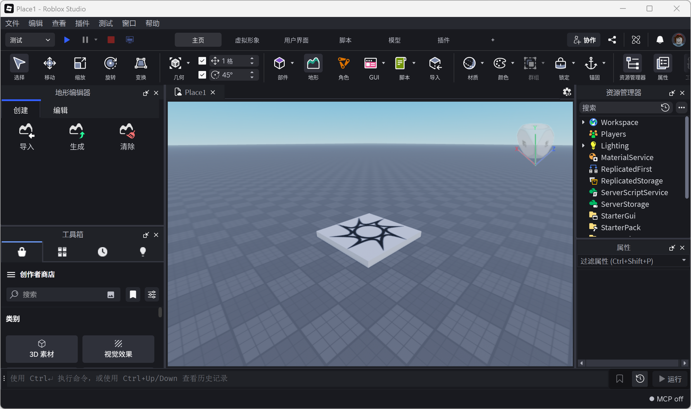
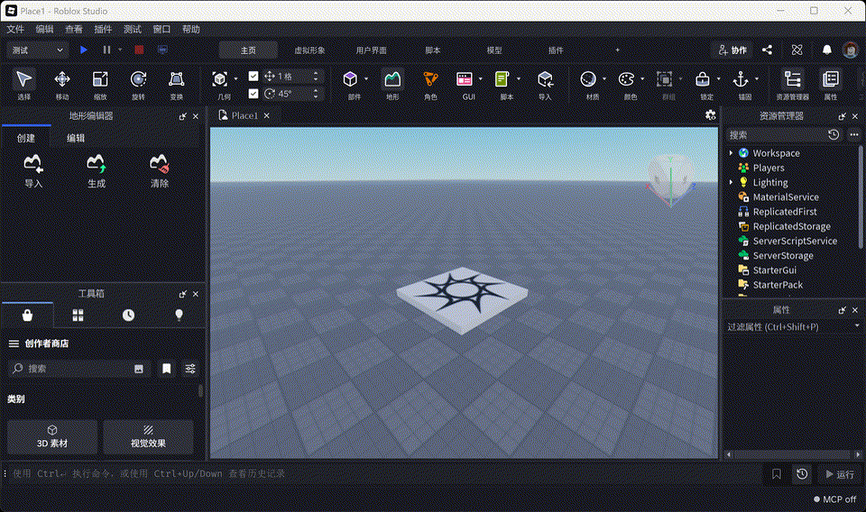

# dcc-mcp-roblox-studio

Roblox Studio adapter for the DCC-MCP ecosystem.

This project is an integration layer for Roblox Studio. It is not an official
Roblox product and it is not a replacement for Roblox Studio's built-in MCP
server. The official server remains the source of truth for Roblox-owned
capabilities. This adapter makes those capabilities available through the
common DCC-MCP control plane, while adding DCC-MCP lifecycle, routing,
multi-instance metadata, auditability, and cross-DCC workflows.

Use this adapter when Roblox Studio needs to participate in the same agent
workflow as Maya, Blender, Houdini, or another DCC. The adapter provides shared
discovery, instance selection, lifecycle management, and cross-DCC routing.
The official Roblox MCP server remains available through the compatibility
namespace when a workflow needs a Studio-owned capability.

The adapter connects an MCP client to an open Roblox Studio session through a
local stdio sidecar and a Studio plugin WebSocket. The sidecar uses
`dcc-mcp-core` for bridge lifecycle and multi-instance routing. The plugin owns
typed Studio API operations and groups writes in one Studio undo record.

When enabled, the adapter also discovers Roblox's installed `StudioMCP`
launcher and exposes its current tool list under the
`roblox_official__*` namespace. Calls are forwarded to the official server,
including rich content such as screenshots. This compatibility route avoids a
second implementation of Roblox-only services such as asset generation,
Open Cloud, and Studio-side playtest automation.

<!-- dcc-mcp-coverage-pointer:start -->
<!-- Generated from dcc-mcp-catalog.yml by scripts/generate_adapter_pointer.py in dcc-mcp/dcc-mcp-core. Do not edit by hand. -->
## Part of the DCC-MCP host matrix

**dcc-mcp-roblox-studio** — Roblox Studio adapter with a Luau plugin, typed Studio
operations, and instance-routed WebSocket bridge.

It is one of **49 host adapters** in the DCC-MCP catalog. Every adapter speaks the same
MCP protocol and builds on the same core runtime contract; each one exposes the tools
its own host needs on top of that.

- [All host adapters and install metadata](https://dcc-mcp.github.io/ecosystem)
- [Host matrix on the core README](https://github.com/dcc-mcp/dcc-mcp-core#readme)
- [Showcase](https://dcc-mcp.github.io/showcase)

This block is generated from the catalog entry in
[`dcc-mcp-catalog.yml`](https://github.com/dcc-mcp/dcc-mcp-core/blob/main/dcc-mcp-catalog.yml).
Re-run the generator after changing the catalog.
<!-- dcc-mcp-coverage-pointer:end -->

## Install

The package is published on PyPI as `dcc-mcp-roblox-studio`. It requires
`dcc-mcp-core>=0.20.54,<0.21.0`.

```powershell
python -m pip install dcc-mcp-roblox-studio
```

For development:

```powershell
python -m pip install -e ".[dev]"
```

## Connect

Build the local plugin model:

```powershell
python plugin/build_plugin.py
```

Copy `plugin/RobloxStudioDccMcpPlugin.rbxmx` into the Roblox Studio local
Plugins folder, restart Studio, and enable HTTP requests in Studio.

Start the adapter with official compatibility enabled:

```powershell
dcc-mcp-roblox-studio --ws-port 9001 --enable-official-mcp
```

MCP client configuration:

```json
{
  "mcpServers": {
    "dcc-mcp-roblox-studio": {
      "command": "dcc-mcp-roblox-studio",
      "args": ["--ws-port", "9001", "--enable-official-mcp"]
    }
  }
}
```

Call `roblox_list_studios` first when several Studio sessions are running.
Pass its `studio_id` to subsequent native tools. Official compatibility tools
use the `studio_id` contract defined by the installed official server.

## Native DCC-MCP tools

- `roblox_list_studios`
- `roblox_get_studio_state`
- `roblox_search_game_tree`
- `roblox_inspect_instance`
- `roblox_script_read`
- `roblox_multi_edit`
- `roblox_script_search`
- `roblox_script_grep`
- `roblox_create_instance`
- `roblox_modify_instance`
- `roblox_delete_instance`
- `roblox_clone_instance`
- `roblox_move_instance`
- `roblox_get_selection`
- `roblox_set_selection`
- `roblox_insert_service`
- `roblox_undo`
- `roblox_redo`
- `roblox_get_console_output`
- `roblox_start_stop_play`
- `roblox_save_place`

All native write operations use typed parameters and an undo recording where
Roblox Studio exposes `ChangeHistoryService`. Arbitrary Luau execution and
native UI input stay on the official compatibility route or the DCC-MCP
`ui-control` skill when those capabilities are required.

## Official capability compatibility

The official server changes with Roblox Studio. With `--enable-official-mcp`,
the adapter queries `tools/list` from the installed `StudioMCP` process and
surfaces the current official schemas without hard-coding a stale tool list.
The exposed names are prefixed with `roblox_official__` so native and official
routes remain unambiguous.

The compatibility route covers the official categories, including script
operations, DataModel exploration, Luau execution, asset search and insert,
AI generation, playtesting, console output, screenshots and video capture,
player input simulation, documentation and skills, place saving, feedback,
and Open Cloud calls when the Studio account and permissions allow them.

To point the adapter at a non-default launcher, set
`DCC_MCP_ROBLOX_OFFICIAL_MCP` or pass `--official-mcp-command`.

## Product boundary

This project is an independent compatibility layer for the DCC-MCP ecosystem.
It is not an official Roblox product and it is not a replacement for Roblox
Studio's built-in MCP server. Roblox's server remains authoritative for
Roblox-owned behavior and Studio features.

Use Roblox Studio's built-in MCP server for the official Roblox experience and
the newest Studio-owned capability directly. Use this adapter when Roblox
Studio should participate in a DCC-MCP fleet with shared discovery, routing,
lifecycle control, structured bridge metadata, auditability, and the same
operational workflow as other DCC hosts. The official server remains available
through `roblox_official__*`, so the two routes can be used together in one
agent workflow.

The adapter is especially valuable when an agent must coordinate Roblox Studio
with Maya, Blender, Houdini, Photoshop, or another DCC. One DCC-MCP discovery
and call contract can select the right Studio instance, invoke native typed
tools, forward newly exposed official tools, and preserve the same gateway and
operational model across the fleet. That combined capability is the reason to
use and recommend this project alongside Roblox's official MCP server.

## Real example

The [neon checkpoint workflow](docs/examples/neon-checkpoint.md) creates a
visible, undoable scene change through typed MCP calls. It shows the complete
loop from Studio discovery to inspection, selection, undo, and save.

Use the workflow as a first smoke test after installation. It leaves a clear
object in the place, so the result is easy to review in Studio and useful for a
real showcase capture.

## Installation evidence

The images below document the plugin installation flow. They are supporting
evidence for setup, while the executable example above demonstrates the
adapter's value.





## Standalone official route

Roblox Studio also provides an official local stdio MCP server. The DCC-MCP
translator can expose it through the gateway:

```powershell
dcc-mcp-server translate `
  --stdio "`$env:LOCALAPPDATA\Roblox\mcp.bat" `
  --app-type roblox-studio `
  --expose-streamable-http true
```

Use the adapter's compatibility mode when the official server should be part
of the same Roblox adapter process. Use the standalone translator when the
official server should have its own gateway registration.

## Development

```powershell
python -m ruff check src tests
python -m ruff format --check src tests
python -m pytest
python -m build
```

See [architecture](docs/architecture.md) and the [live smoke test](docs/live-smoke.md).
See the [capability matrix](docs/capability-matrix.md) for the native, official,
and shared DCC-MCP coverage boundaries. The [capability roadmap](docs/roadmap.md)
lists the next safety and workflow improvements.

## License

MIT. Roblox and Roblox Studio are trademarks of Roblox Corporation.
